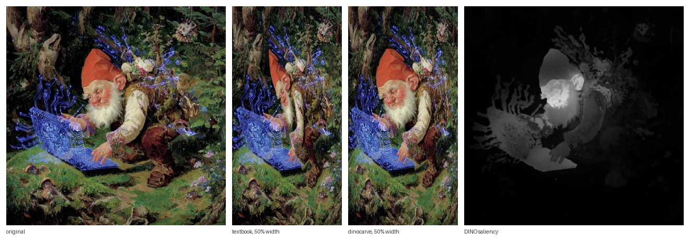

# dinocarve

Content-aware image resizing that keeps the subject. Seam carving is guided by a frozen DINOv2 model, compiled once on the GPU, and resized in the browser with no model at runtime.



*Left to right: the original, textbook seam carving at 50% width, dinocarve at 50% width, and the DINO saliency that guides it. Regenerate with `python examples/make_figure.py`.*

## Why

Classical seam carving removes the pixels with the least local contrast. A subject is often the smoothest area in the image, so the textbook algorithm removes the face and keeps the busy background. dinocarve adds two costs from DINOv2:

- **Saliency.** The class token's attention in the last block marks what the image is about. Removing a pixel costs `10 × saliency`.
- **Part budget.** k-means on block-8 features splits the image into 12 parts. Removing a pixel of part *c* costs `2 × (fraction of c removed) / (fraction of the image removed)`, so no part is carved away whole.

Both maps come from DINOv2-S/14 with registers. JAFAR lifts them from the 14px token grid to pixels.

## Quickstart

```bash
pip install -e .                          # torch, numpy, pillow, einops
python -m dinocarve photo.jpg out/photo   # first run downloads DINOv2 (~90 MB) and JAFAR (~7 MB)
python -m http.server 8000                # then open http://localhost:8000/web/index.html
```

The compiler writes `out/photo/{image.jpg, rank.png, carve.json, saliency.png}`. Show it in any page:

```html
<script type="module" src="web/dinocarve.js"></script>
<carved-image src="out/photo/" style="width: 300px; height: 400px"></carved-image>
```

Compare against the classical algorithm with `--method textbook`. Other options are `--max-height` (default 1024), `--fraction` (the largest share of the width that can be removed, default 0.6) and `--device`.

## How it works

1. **Compile (Python, GPU, one time per image).** `dinocarve/seams.py` removes the cheapest vertical seam, records the step, updates the costs, and repeats K times. The output is a rank map: `rank[y][x]` is the step that removes pixel (x, y), or 65535 for never.
2. **Resize (browser, every frame).** Removing k seams keeps exactly the pixels with `rank ≥ k`. Each row keeps W−k pixels in order, so any width up to K is one pass over the rank map.

The seams are nested. The seams removed for 60% width include all seams removed for 80% width. This makes resizing smooth and stable, and the compile does not depend on the target size.

## Web component

`web/dinocarve.js` is one dependency-free ES module.

- `<carved-image src="dir/">` fills its CSS box. It picks k so the carved aspect matches the box. If the box is narrower than the minimum width or wider than the image, it letterboxes and never crops or stretches.
  - `width-percent="N"` fixes the width at N% of the image instead.
  - Read-only properties: `k`, `width`, `naturalWidth`, `maxRemove`.
  - Each render fires a `carved` event with `{k, width, ms, backend}`.
- `<carved-gallery>` is a CSS grid of `<carved-image>` cells with fixed row heights. Each cell recarves to its own aspect when the window resizes.

Performance details:

- **WebGPU.** One compute dispatch compacts every row, and a render pass draws the result. Image and rank data are uploaded one time per image and shared by all elements.
- **CPU fallback.** It is used when WebGPU is not available, or when a WebGPU draw fails. The output pixels are identical.
- **Caching.** Each `src` is fetched and decoded one time per page, however many elements show it.
- **Lazy loading.** An element loads and draws nothing until it is within 200px of the viewport.

## Output format

| File | Content |
|---|---|
| `carve.json` | `{"version":1, "width":W, "height":H, "max_remove":K, "never":65535, "image":"image.jpg", "rank":"rank.png", ...}` |
| `image.jpg` | The W×H image at compile resolution. |
| `rank.png` | Lossless RGB. `rank = R*256 + G`. |
| `saliency.png` | The DINO saliency (only for `--method dino`, not used by the browser). |

## Measured

- **Compile.** The 1024×1024 gnome example (614 seams) takes 4.7 s on an RTX A5000, including DINO and JAFAR. The textbook method takes 2.3 s.
- **Determinism.** Compiles are deterministic. Three runs in separate processes gave byte-identical `rank.png` files.
- **Browser render.** One resize of the 1024×1024 example takes about 6.5 ms on the CPU path, measured in headless Chromium. The WebGPU path was only tested on SwiftShader, a software GPU, so its timing is not meaningful.

## Files

```
dinocarve/seams.py      energy, seam DP, nested rank map, k-means, PCA, PNG encoding
dinocarve/dino.py       DINOv2-S/14-reg saliency and part features, JAFAR upsampling, model download
dinocarve/kernel.py     fused Triton seam kernel (used on CUDA, with a PyTorch fallback)
dinocarve/__main__.py   the compile command
dinocarve/jafar/        JAFAR model code, vendored (Apache-2.0)
web/dinocarve.js        <carved-image> and <carved-gallery>
web/index.html          demo: textbook vs dinocarve slider, and a gallery
examples/               the compiled gnome (dino and textbook) and the README figure script
tests/test_seams.py     CPU tests of the carving core
```

## Credits

- Seam carving: Avidan and Shamir, SIGGRAPH 2007. Forward energy: Rubinstein, Shamir and Avidan, SIGGRAPH 2008.
- DINOv2 ([arXiv:2304.07193](https://arxiv.org/abs/2304.07193)) and registers ([arXiv:2309.16588](https://arxiv.org/abs/2309.16588)), loaded from `facebookresearch/dinov2` with torch.hub.
- JAFAR ([arXiv:2506.11136](https://arxiv.org/abs/2506.11136)), code vendored from [PaulCouairon/JAFAR](https://github.com/PaulCouairon/JAFAR) under Apache-2.0. See `dinocarve/jafar/LICENSE`.

MIT license for everything else.
